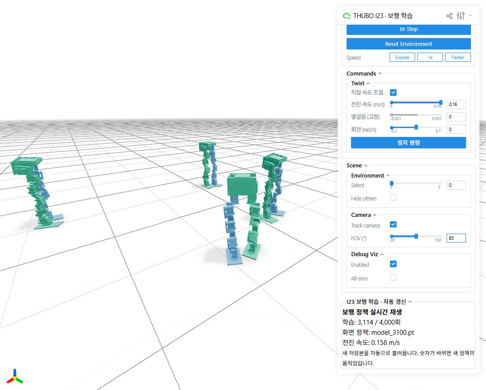

# I23 보행 학습 — 2026년 11월 12~13일

I23 형상으로 **PPO 4,000회 학습**을 실행하고 최종 네이티브 체크포인트 `model_3999.pt`를 보존했습니다. 512개 병렬 환경, 환경당 32개 전이, 50 Hz 제어를 사용했습니다. 보행은 절차적으로 만든 교대 발 접촉·발 들기·자세·속도 추종 보상으로 유도했습니다. 사람 모션캡처나 AMP 학습은 사용하지 않았으며, 사람 같은 보행 또는 실물 성능이 검증됐다는 뜻은 아닙니다.

[학습 모델과 기록 다운로드](https://github.com/DME-THUBO/THUBO_rl_mjlab/releases/tag/i23-walk-20261112)

## 저장된 정책을 Viser에서 재생

기존 환경 설치 방법은 저장소 루트 README를 따릅니다. 릴리스의 `model_3999.pt`를 `logs/i23_release/`에 저장한 뒤 실행합니다.

```bash
conda activate THUBO_mjlab
python -m pip install -e .
python scripts/play_hotload.py THUBO-I23-Human-Walk logs/i23_release --device cuda:0 --num-envs 4 --port 8082 --status-file AAAMigration/I23_training_20261112/training_status.json
```

브라우저에서 `http://127.0.0.1:8082`를 엽니다. 화면은 저장된 정책을 별도 시뮬레이션에서 재생하며, 학습 환경 자체를 중계하는 것은 아닙니다. 같은 폴더에 새 `model_*.pt`가 생기면 자동으로 불러옵니다. 전진·회전 조절과 정지 명령을 사용할 수 있습니다. 학습 전진 범위는 0.04~0.16 m/s이며, 정지 명령의 동작은 별도 성능 보장이 아닙니다.

`--status-file`을 생략하면 저장 정책 재생으로 표시됩니다. 기본 재생 기록은 `RUN_DIR/viewer_state/`에 저장되므로 원래 작업 폴더나 Windows 사용자 경로가 필요하지 않습니다. 위 상태 JSON은 이번 완료된 학습의 고정 기록입니다.

## 같은 설정으로 새 학습

```bash
python scripts/train.py THUBO-I23-Human-Walk
```

학습과 정책 재생 화면을 함께 시작하려면:

```bash
python scripts/train_with_viser.py THUBO-I23-Human-Walk --num-envs 512 --iterations 4000 --save-interval 50 --viewer-num-envs 4 --viser-port 8082
```

`scripts/train.py`는 `DME_THUBO_NUM_ENVS`, `DME_THUBO_NUM_STEPS`, `DME_THUBO_MAX_ITERATIONS`, `DME_THUBO_SAVE_INTERVAL`, `DME_THUBO_LOG_ROOT`를 지원합니다. I23 실행은 기본적으로 CUDA GPU 0과 NaN 검사를 사용합니다. 재개 시 `DME_I23_RESUME_CHECKPOINT`는 실재하는 네이티브 체크포인트로, 로그 루트는 기존 `thubo_i23_human_walk/<실행 폴더>`를 포함하는 위치로 지정합니다. HoST의 별도 체크포인트 형식과 혼용하지 않습니다.

## 실제 사용한 설정

| 항목 | 값 |
| --- | --- |
| 작업 / 관측 / 행동 | THUBO-I23-Human-Walk / 47 / 12 |
| PPO / 환경 / rollout | 4,000회 / 512개 / 32 step |
| 제어 / 물리 간격 | 50 Hz / 0.002 s × decimation 10 |
| 전진 / 횡방향 / 회전 명령 | 0.04~0.16 m/s / 0 / ±0.1 rad/s |
| 보행 주기 / swing 비율 / 발 높이 | 1.0 s / 0.4 / 목표 0.02 m |
| actor / critic | 256, 128 / 256, 128 |
| 초기 학습률 / gamma / lambda | 0.0003 / 0.99 / 0.95 |
| 토크 제한 | 임시 1.40 N·m — 실측 미확인 |
| 시드 / 저장 간격 | 42 / 50회 |

전체 설정은 [settings.json](settings.json), 마지막 학습 메트릭과 완료 기록은 [training_status.json](training_status.json)에 있습니다. 모델 질량은 약 2.941232 kg입니다. 충돌은 I23 관성·시각 메시와 단순화한 박스/캡슐을 사용하며, 바닥 및 다리 사이 접촉을 켰습니다. 실제 케이블·관절 유격·출력물 강도와 실물 서보 특성은 검증하지 않았습니다.

## 릴리스 자료

- `model_3999.pt`: 최종 네이티브 RSL-RL 체크포인트, actor·critic·optimizer 포함.
- `I23_Training_20261112.zip`: 최초 실행과 재개 실행의 저장 체크포인트·TensorBoard 이벤트·설정·콘솔·재개 기록. 개인 컴퓨터 경로는 문서용 표기로 바꿨습니다.
- `I23_Original_Training_Source.zip`: 실제 학습에 사용한 로컬 커밋 `60e50662d0e346c176c710bf3c3f7383120ba69c`의 소스 스냅샷. 이 저장소의 새 코드는 재생 경로를 이식 가능하게 정리한 버전입니다.
- `SHA256SUMS.txt`: 릴리스 자산 검증 값.

최종 체크포인트 SHA-256: `003a2a9282c98869e31df648d5aadbde7cdf6642c2bc47d1567ea6063cd59eab`.

## 확인한 것과 남은 것

최종 체크포인트의 native iteration은 3999이고 저장 텐서는 모두 유한값입니다. I23 모델·중립 자세·관측 크기·CUDA 학습/저장/재생과 기존 작업 계약 검사는 업로드 시 별도 실행한 [검증 기록](PUBLICATION_VALIDATION.md)을 참고하세요. 4,000회 완료는 번호와 저장 상태에 대한 기록이며, 자연스러운 사람 보행·지속 무보조 기립·실물 보행 성공을 뜻하지 않습니다.



위 스크린샷은 학습 도중 `model_3100.pt`를 재생하던 화면입니다. 최종 정책의 성능 평가 자료로 취급하지 않습니다.
