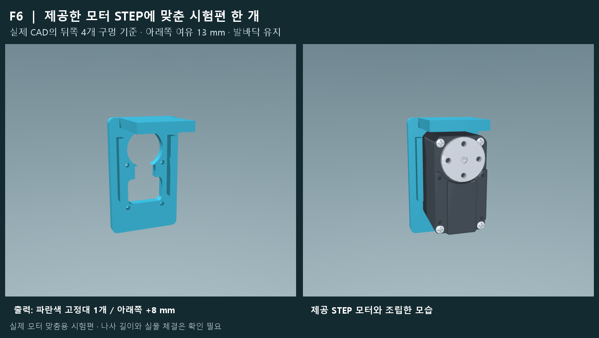
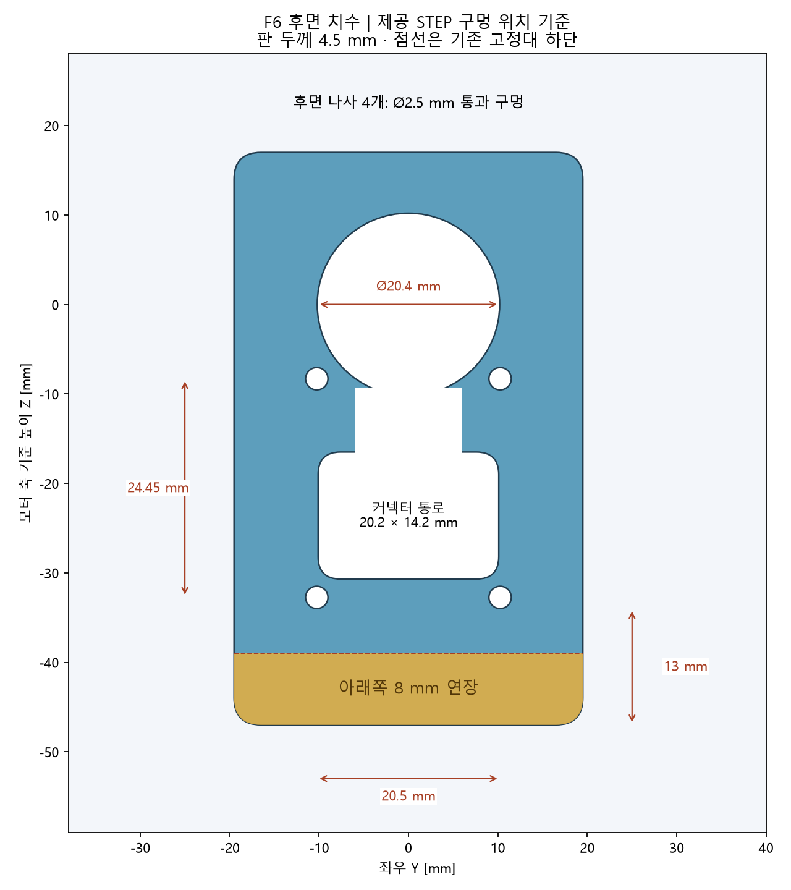
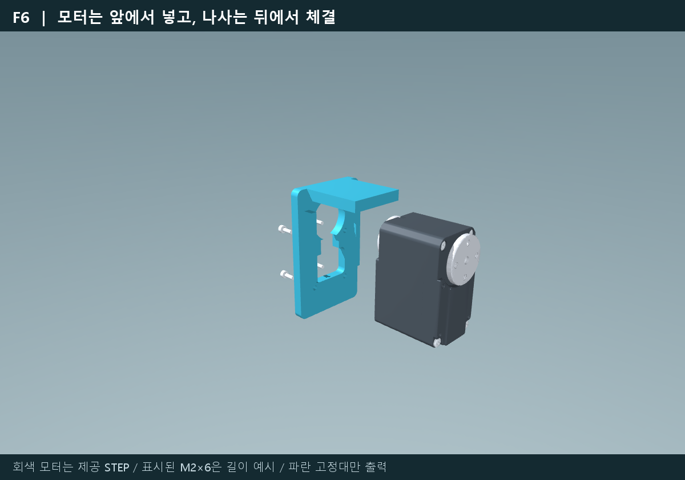

# F6 rear motor mount — single fit-test part

Preserved version: [`stl-f6-rear-mount-20261113`](https://github.com/DME-THUBO/THUBO_rl_mjlab/releases/tag/stl-f6-rear-mount-20261113).

Print **one** [F6 STL](STL/F6_STEP_Rear_Motor_Mount.stl), or open the [Bambu A1 project](A1_PROJECT/F6_STEP_Rear_Motor_Mount.3mf). [Editable part STEP](CAD/F6_STEP_Rear_Motor_Mount.step) is also included. This is the F6 single-motor trial made from the supplied motor STEP, with extra material below the lower screws. The soles and the existing I23 robot model are unchanged.

## Geometry

| Feature | Value |
| --- | --- |
| Rear fastener layout | 20.5 × 24.45 mm, derived from the supplied STEP |
| Fastener clearance | Four Ø2.5 mm through holes |
| Hole rows relative to motor axis | −8.3 / −32.75 mm |
| Plate thickness | 4.5 mm |
| Lower extension compared with F5 | +8 mm |
| Lower hole edge to bottom | 13 mm |
| Rear circular relief | Ø20.4 mm for the modeled Ø19.2 mm feature |
| Lower relief | 20.2 × 14.2 mm, R2.5 |
| Print bounds | 64 × 39 × 34.3 mm |

## Printing and fit check

Bambu Lab A1, PLA, 0.4 mm nozzle, 0.2 mm layers, six walls, 45% gyroid, no supports. The STL is already oriented flat rear face down. The supplied slicer estimate is 15.23 g and 60 min 38 s. The CAD STEP retains the motor-coordinate orientation.

Insert the motor from the open front, check the rear protrusion and actual cable/plug clearance, then align all four holes. Confirm the real motor's screw specification and useful depth before choosing screw length. M2×6 shown in the reference image is illustrative.

## Verification and limits

This publication preserves the exact previously checked F6 STL and A1 3MF bytes. The STL is a closed single volume, the 3MF archive passes CRC, and its source mesh hash matches. Earlier CAD checks found no modeled overlap for motor seating, conservative insertion envelopes, screw insertion and straight tool access at a 0.01 mm³ threshold. See [publication checks](CHECKS/publication_validation.json), [fit/access checks](CHECKS/fit_and_access.json) and [slicing record](CHECKS/slicing.json).

Physical fit, screw engagement and strength are unverified. The minimum nominal material between a screw hole and relief is about 1.5 mm. This is one fit-test mount, not a completed whole-leg redesign or a hardware walking release.

Input provenance: `st-3250m-20211119-B.stp`, SHA-256 `4182ac210720ac5d0a0724aaf29d0d5fbfa58c98439a1431cbaabb80ac6ac201`. Its internal header identifies `ST-3235M-20211119-A_ASM`, so verify that it matches the physical motor. The input motor assembly is not a printable part in this package.

The tag preserves this revision independently of the overnight I23 training PR. Use a new tag for subsequent design revisions. [SHA256SUMS.txt](SHA256SUMS.txt) records the preserved files.
