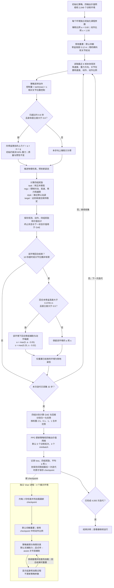

# HoST 从倒地到起身的训练迭代

本图对应 THUBO 默认的 `relative` 动作模式：2,048 个训练环境、4,000 次 PPO 迭代，每次迭代每个环境采集 32 个控制步。单个回合最长 10 秒；回合重置与 PPO 更新是两个独立循环，回合可以跨越多次 PPO 迭代。

## 奖励怎样引导起身

四组奖励的标量返回值为 `2.5 × task + 0.1 × regu + style + target`。实际 HoST 训练器读取四组原始奖励，分别计算、归一化优势后再加权更新策略。

| 奖励组 | 当前实现与引导作用 |
| --- | --- |
| `task` | 身体直立评分乘以骨盆相对双踝参考点的高度评分。连续鼓励身体转正、撑高；THUBO 目标高度为 0.39 m。 |
| `regu` | 惩罚动作变化、关节速度、力矩、机械功率和关节越限，限制粗暴动作。 |
| `style` | 惩罚偏离默认关节姿态；骨盆高度超过 0.3705 m 后，还约束双脚横向间距接近 0.12 m。 |
| `target` | 骨盆高度超过 0.3705 m 后，奖励低横滚/俯仰角速度、低水平速度、身体直立和接近 0.39 m 高度。 |

策略没有预设“翻身—收腿—撑起”的动作序列，需通过探索和奖励反馈学习。向上辅助力只在身体接近直立后开启，主要降低后半段撑起的难度；每个训练环境按自身回合末表现独立减少辅助。

## 如何判断已经学会

课程通过条件只看回合末的高度和直立度，没有要求持续站稳。四环境查看器默认无辅助，能够展示无辅助起身，但它不能替代批量成功率评估。

正式验证使用 `scripts/host/eval.py`，分别检查仰躺、俯卧和左右侧躺；默认评估要求零辅助，在高度、直立度及速度均达标时持续站稳至少 0.5 秒。

## 实现位置

- [config.py](config.py)：奖励注册、10 秒回合和事件配置。
- [mdp.py](mdp.py)：倒地重置、四组奖励、辅助力及课程递减。
- [ppo.py](ppo.py)：四组 GAE、优势归一化与 PPO 更新。
- [训练入口](../../../scripts/host/train.py)：采样、手动回合重置、迭代与 checkpoint 保存。
- [训练与查看器入口](../../../scripts/train_with_viser.py)：四环境展示和 checkpoint 热加载。
- [恢复评估入口](../../../scripts/host/eval.py)：无辅助持续站稳评估。
